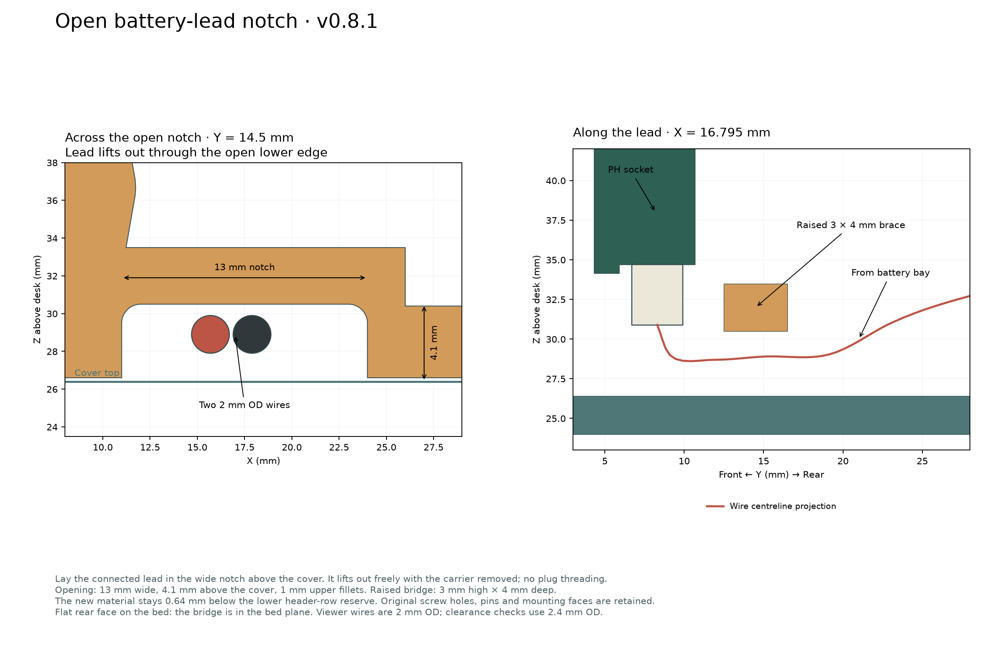

# Open battery-lead notch — v0.8.1 (notch unchanged from v0.8)

**Reprint only [03-feather-frame.stl](../prototype-stls/bare-scd30/03-feather-frame.stl) if you have v0.8 or v0.7.1.** Both print folders contain this same frame. The shell and both sensor carriers are byte-for-byte unchanged. The Feather's mounting holes, locating pins, PCB seat plane and sliding interfaces retain their fitted geometry. v0.8.1 additionally widens both screw collars; see [mount details](FEATHER-MOUNT.md).

The left section of the lower crossbar is raised towards the Feather, leaving a **13 mm-wide, open-bottom notch** between the upright and the USB-arrow land. The clear height above the closed carrier is **4.1 mm**. The raised bridge is **3 mm high × 4 mm deep**, with **1 mm internal corner radii** where it joins its supports.

The lead rests in this broad opening. **There is no closed loop to thread and no need to unplug the PH connector to release the cable from the frame.** The connected lead can lift out through the open edge when the carrier is removed. The socket helps locate it; leave a relaxed bend and lay the wire in the notch before closing.

[Personal interactive model](variants/bare-scd30/model.html) · [Workshop model](model.html) — choose **Battery cable** for a close-up. [Measured sections](battery-lead-notch.pdf).

## Assembly and service

1. Fit the Feather to its frame and install it as usual. The battery can stay plugged into the Feather while fitting or removing the frame from the board.
2. With the carrier off, lay the two battery wires in the wide notch. No plug threading is needed. Keep the spare lead relaxed in the battery bay above the carrier.
3. Close the carrier, checking that the lead occupies the opening and other loose wires clear the closing rim.

To release the Feather from the bracket, remove the carrier and lift the battery lead out of the open notch. Support the connected battery and board while bringing the frame out for screw access. The available lead slack determines how far they can move; do not pull on the socket. The frame does not enclose the battery lead.

## Print and verification

Use the supplied STL orientation: **flat rear face on the bed, mounting pads up**. The raised bridge lies in the bed plane, so it adds no unsupported roof. Keep the existing frame settings; no additional support is intended. No slicing was performed.

The HTML now shows **two 2 mm-diameter wires**. The [geometry check](generated/battery-lead-checks.json) uses larger **2.4 mm-diameter wire envelopes**, checks the carrier through 81 closing positions, and verifies free removal of a **5.2 × 2.4 mm bundle** at 275 positions through the notch. The old crossbar fails that release check.

The new brace also clears reserves around **all 28 header pads**, located from the manufacturer PCB file. Each reserve is 2.54 mm square and extends 12 mm behind the PCB; the new material is **0.64 mm below the lower row's reserve**. This checks the added brace, not every possible header body or accessory.

The full mounting-hole audit and detailed Feather-component checks are repeated for the released STL. These are geometric checks; try the revised frame with the real wires before printing a batch.
