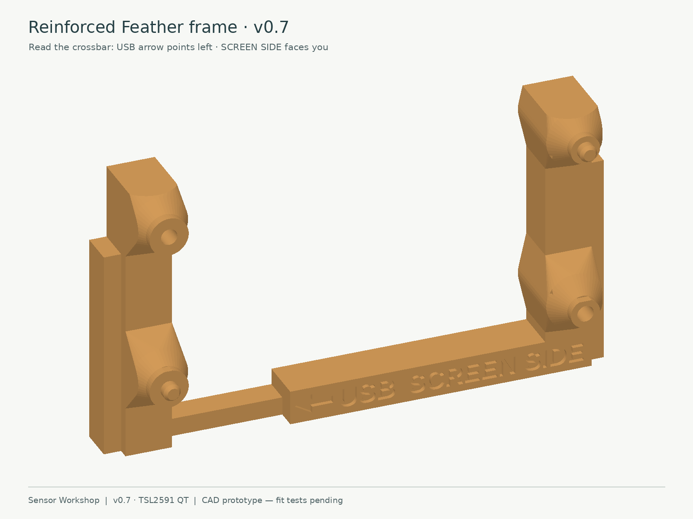

# Feather mount — seating correction v0.7

**Reprint [03-feather-frame.stl](../production-stls/03-feather-frame.stl).** The standard shell and carrier are unchanged. The personal bare-SCD30 set also has an updated snap carrier; use its [complete print folder](../prototype-stls/bare-scd30/). [Mounting drawing](feather-mounting.pdf) · [Interactive model](model.html)

## What caused the clearance problem

On 25 November 2026, Erez reported that the new frame did not align as the older one had, and that the UP marking was unclear. Direct measurements of the exported v0.5 and v0.6 STLs show **identical screw-hole and locating-pin centres**. However, checking Adafruit's detailed STEP model revealed that the enlarged v0.6 USB-end posts **overlapped the CHG and D3 LED packages**. The old posts clear those parts. This interference can stop the board seating flat; the earlier simplified board model omitted these LEDs.

v0.7 restores the original **4.3 mm USB-end and 3.2 mm antenna-end contact diameters**, with a genuine **1 mm straight land** before the reinforcement widens. Local reliefs leave room around the LEDs, radio and antenna. The contact footprints fit inside the old v0.5 footprints. The **6.4 mm roots** and broad connections to the uprights remain, supporting the threaded section behind the narrow contact lands.

All four mounting centres remain at their original positions. The locating pins retain their 1.9 mm bases and gain tapered entry tips. Screw pilots remain **Ø1.8 × 6 mm deep**, preserving the previously successful pilot diameter. No screw size or quantity changes.

The lower crossbar reads **USB**, with an arrow pointing to the connector end, and **SCREEN SIDE**. Only the clear right half of the crossbar is taller and brought forward for readable lettering, preserving the battery-lead passage on the left and the original overall size and slide tongues.

## Correct orientation before tightening

1. Work with the frame **outside the shell**. Face the engraved crossbar towards you, with that crossbar at the bottom.
2. Point the Feather's **USB socket in the engraved arrow's direction**. The **screen and three buttons face you**, on the side marked SCREEN SIDE; the rear components face the mounting pads.
3. Seat both locating pins gently. Confirm that the PCB sits flat against the pads and both screw holes line up before inserting screws. Do not use the screws to pull the board into place.
4. Fit the two screws from the display face with a straight precision screwdriver. Support the nearby upright and tighten gently until seated, keeping the driver off the glass.
5. Slide the complete frame into the shell from its open bottom. For removal, unplug both leads, withdraw the frame, then unscrew the board on the table while supporting the posts.

The [detailed fit check](generated/feather-fit-checks.json) independently compares STL hole/pin centres to the fitted v0.5 frame and to the manufacturer's PCB holes. All **186 STEP solids** clear the corrected frame; the six component-solid overlaps belonging to the two LEDs in v0.6 are removed. The two LEDs are also included in the routine simplified model now. These are nominal geometric checks; the revised print still needs a seating and removal trial.

## What the measured screw tells us

The reported measurements are **approximately 1.8 mm over the thread and 5.5 mm of threaded portion**. That alone does not establish a standard size: metric size also requires pitch, and threaded length may differ from the length measured under the head. M2 has a nominal 2 mm diameter and 0.4 mm coarse pitch; M1.8 also exists, with 0.35 mm coarse pitch. [Bossard metric-thread table](https://media.bossard.com/global-en/-/media/bossard-group/website/documents/technical-resources/en/f-079-en.pdf)

Record the successful pilot fit without labelling these particular screws M2. The [mechanical BOM](MECHANICAL-BOM.md) retains **M2×5 pan-head screws** as the proposed purchase specification, pending a trial with identified screws. If a screw is actually 5.5 mm under the head, the 6 mm blind pilot would leave **2.1 mm nominal tip clearance** through this PCB; that is a conditional calculation, not confirmation of the user's screw length.

## Other screw mounts reviewed

| Mount | Boss / pilot diameter | Nominal radial wall | Support |
| --- | --- | --- | --- |
| TSL2591 / VEML7700 | 4.8 / 1.8 mm | 1.5 mm | 3.5 mm-tall boss directly rooted in the roof |
| DS3231 RTC | 5.2 / 1.8 mm | 1.7 mm | 4.8 mm-tall boss directly rooted in the roof |
| SCD30 | 4.8 / 1.8 mm | 1.5 mm | 4 mm-tall boss directly rooted in the carrier |
| Case closure | 7.6 / 2.6 mm | 2.5 mm | Integrated shell-corner support |

These mounts already have thicker walls and more direct support than the old Feather projections, so they are unchanged in this revision. The TSL2591 component relief affects a locating-pin boss rather than its screw bosses. Each mount still needs a real fastener trial; this audit is not a torque rating.

## Print and repeat the removal trial

Keep the STL's **flat rear face on the bed**. Start with a 0.4 mm nozzle, 0.2 mm layers, **five perimeters** and five top/bottom layers. The broad roots print first and narrow toward the PCB; USB/SCREEN SIDE lettering and component reliefs open upward. No new support is intended, and no slicing has been performed here. PLA remains suitable for the indoor fit trial.

After cooling, fit the board correctly, snug the screws by hand, then gently remove and refit them a few times while supporting the frame near each screw. Inspect for cracks, whitening, loose threads or separation between layers, and confirm that the frame still slides freely. Stop if a screw bottoms out before the board seats. Keep the two remaining locating pins intact.

The CAD checks cover watertight solids, blind bores, reinforced threaded sections, every detailed manufacturer component, old/new hole and pin centres, contact footprints and the full frame insertion path. **Repeated-removal durability remains untested until this print trial.**
