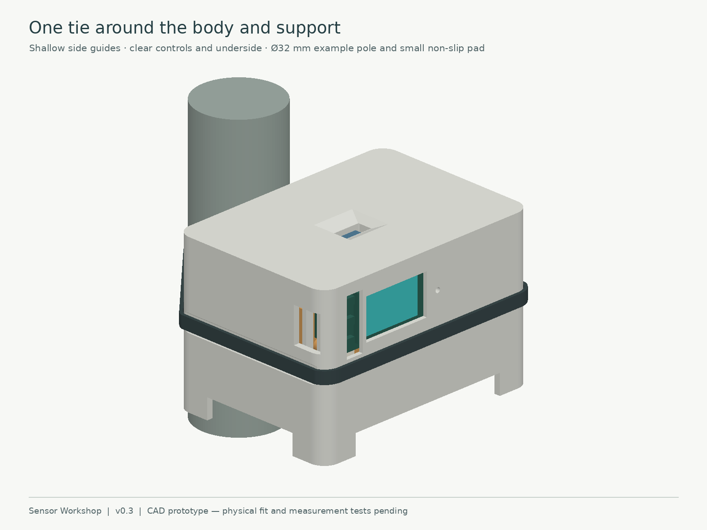

# Mounting away from a tabletop

Use **one external zip tie around the whole enclosure and its support**, guided by shallow grooves in the two side walls. The band sits below the controls. The case keeps its straight feet and three printed pieces; there are no projecting mounting ears.

| Approach considered | Advantage | Tradeoff |
| --- | --- | --- |
| Rear printed anchors | Front remains clear of a strap | Strap force is concentrated at the printed anchors and their roots; threading also needs access behind the case. |
| **Full-body wrap with side guides — selected** | Load is carried around the case walls; no projecting tabs or additional printed part | A band is visible across the lower front. Holding force still depends on tie tension and friction against the support. |

This is a mechanical design rationale, not a tested strength comparison or load rating.

## Route and appearance

The **4.8 mm band** is centred **31 mm above the feet**. Each side groove is **6 mm high and 0.5 mm deep**, with **0.5 mm chamfered transitions**. The grooves extend to the rounded corners so the taut band can seat in them, rather than bridging over a small isolated recess. Side-wall material remains **1.9 mm thick** at the groove.

The band has **1.17 mm nominal vertical clearance below the button opening**, **5.1 mm below the USB opening**, and sits above the carrier joint. Its locking head goes on the **right side**. The light opening, rear vents and downward-facing sensor remain clear of the strap. Keep the device upright with the light sensor on top.

Choose **Pole mount** in the [HTML viewer](model.html). The tie, example pole and pad are individually selectable and hidden in the default tabletop view. They are mounting accessories/reference geometry, not additional printed parts.

## Tie length, grip and assembly

The illustration uses a **Ø32 mm pole** and a small **2 mm non-slip pad** between the case and pole. The calculated tie loop is approximately **337 mm**, before allowance for the locking head and the free tail needed to thread/tighten it. Start with a **4.8 mm wide, 400–450 mm long tie** for this example, then choose the final length for the actual pole or rail. The 150 mm battery ties are separate and too short for this route.

1. Finish assembling and checking the device before attaching it to the support.
2. If needed for grip, place a small non-slip rubber pad behind the band, below the rear vents. The example pad is 18 × 16 mm; its 2 mm thickness also leaves space between the support and the case. Actual compression and grip are not simulated.
3. Run the long tie around both the enclosure and support, seated in both side grooves. Put the head on the right side and tighten only until the device is held firmly; do not deform the case.
4. While supporting the device by hand, check that it does not slide down, twist around the pole or tip forward. Confirm the buttons, USB access and bottom carrier are still usable. Adjust the pad/attachment if the grip is insufficient rather than crushing the shell tighter.

The same principle works with a rail or wire-mesh support. A **bare wall needs a suitable wall-mounted eye or bracket** through which the tie can pass; there is no dedicated screw/keyhole mounting interface in the case. Site-specific anchors, tie suitability and long-term retention still need a pilot check.

The pole example is a nominal geometric route. It does not simulate tie tension, friction, printed-plastic creep or mounting loads. Mounting may also change airflow and temperature bias; include the intended mounted arrangement in the existing thermal pilot test.

## Battery end stops

The two small printed battery end stops have been removed. The battery stays in its cradles with the two internal ties. A centred Ø20 × 72 mm pack has **7.6 mm nominal space to each side wall**, so axial retention now relies on friction, not hard stops. Check for sliding and lead pull during the pilot; use the existing option of thin soft padding if needed, without overtightening the ties.
