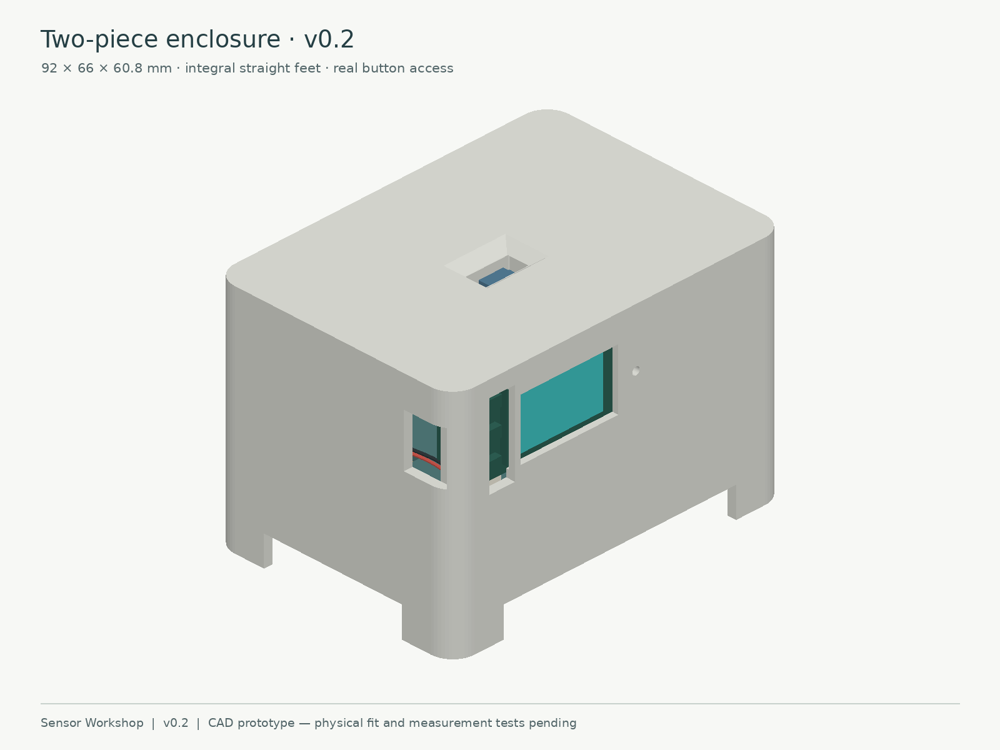

# Enclosure v0.2 — two printed parts

This revision replaces the original 11-piece enclosure with **one main shell and one bottom carrier**. The shell includes the top, four straight corner feet, the open-bottom radiation skirt, board mounts and battery cradles. The SCD30 faces downward from the carrier, without a separate sensor box. The Feather's real buttons are reached through a front slot. The battery connects directly to the Feather and is held with two zip ties.

The assembly is **92 × 66 × 60.8 mm**. Its body footprint is **35.5% smaller** than v0.1. This is still a CAD prototype: print the shared fit coupon and build one pilot before producing classroom quantities.

## Open and compare

- **[Interactive HTML model](model.html)** — one offline file with 26 component checkboxes, an explosion slider, movable cutaways, and an **Underside** camera. “Look inside” hides the shell. Download the file and open it in a browser; GitHub's file page displays source.
- [Eight-page design review](design-review.pdf), [measured cross-sections](sections.pdf), [mounting drawings](mounting-drawings.pdf).
- [OpenSCAD source](sensor-workshop.scad), [editable dimensions](parameters.scad), [current STL set](stl/), [mechanical BOM](hardware.csv).
- [Previous v0.1 viewer](archive/v0.1/model.html) and [archived design](archive/v0.1/README.md) for comparison.
- [Manufacturer references](../hardware/reference/README.md) and [hole-coordinate CSV](generated/mounting-holes.csv).



| Per device | v0.1 | v0.2 |
| --- | ---: | ---: |
| Printed pieces | 11 | **2** |
| Screws | 22 | **10** |
| Nuts | 8 | **0** |
| Body footprint | 112 × 84 mm | **92 × 66 mm** |
| Printed height | 78.4 mm | **60.8 mm** |
| Separate feet / plungers / sensor enclosure | Yes | **None** |
| Inline battery switch | Yes | **Removed** |

## Construction and sensor placement

The main shell prints **roof down**. This avoids suspending a large floor over the feet. All four feet and the skirt grow from the side walls in the same print. The carrier prints **flat upper face down**, with its SCD30 bosses pointing upward on the build plate. It fits through the open skirt, seats against an internal shoulder, and is secured with two M3×8 screws from underneath.

The Feather, light board and RTC mount inside the shell. The four-hole boards use two diagonal screws and two printed locating pins, with support under all four corners. The RTC retains its two screws and thin washers. All **eight board screws are M2×5**, selected to give engagement without protruding through the shallower front wall. Do not substitute the old M2×6 front screws.

The light sensor remains upward-facing behind a flared roof opening and opaque light well. The SCD30 mounts upside down below the carrier with **1.065 mm clearance** above its underside pins. Its sensing body is **11.43 mm above the table**, and the surrounding skirt ends at **8 mm above the table**. Air reaches it through the open bottom; there is no lower tray floor, separate roof, or double-wall vent cage.

The carrier shades the sensor from above, and the perimeter skirt reduces direct light from the sides. This is a simple shade, not a validated outdoor radiation shield. Low-angle/reflected sunlight, table heating and heat conducted from the electronics still need measurement. Sensirion's guidance supports keeping the sensor below and away from heat sources and avoiding direct sunlight. [SCD30 design-in guide](https://sensirion.com/media/documents/84D49268/616536CB/Sensirion_CO2_Sensors_SCD30_Design-In_Guidelines_D1.pdf)

The three real Feather buttons are behind one **7 × 22 mm slot**, about **2.4 mm recessed**. No little printed buttons are required. Finger/nail access and BOOT/RESET recovery must be checked on the pilot. The separate reset hole accepts a small blunt tool. A recessed internal pocket clears the display glass and reset switch body.

## Battery and cables

Buy the protected, prewired **1S 18650 pack locally in Israel**, around 2,200 mAh, within the **Ø20 × 72 mm** design envelope. Its JST-PH polarity must match the Feather. The bay provides 76 mm between upper end stops. It is based on the [Adafruit reference pack](https://www.adafruit.com/product/1781); the wrapped local pack, protection board and lead exit still need measuring.

Two **2.5 mm nylon zip ties**, approximately 150 mm long, pass through short tunnels in the roof-mounted cradles. Their heads sit below the pack. Tighten only enough to retain the protected pack; do not compress it. Thin soft padding can take up clearance for a smaller pack. This avoids depending on a tight snap fit across varying batteries and PLA/PETG flexibility. Battery replacement requires cutting the ties.

There is **no inline switch or extension**. The battery lead goes directly to the Feather, removing the previous 508 mm coil. Target roughly 70–100 mm of prewired battery lead and check it in the pilot. Full power disconnection requires unplugging the battery through the opened carrier; software sleep remains a firmware option.

The RTC is rotated 90° so its QT sockets face front/rear, improving plug clearance and routing. The tentative chain remains:

**Feather — 100 mm — RTC — 50 mm — VEML7700 — 100 mm — SCD30**

Use the assortment for the pilot, then freeze bulk lengths after checking real plug bodies and a service loop for lowering the carrier. The three smooth cable illustrations have approximately **90, 35 and 56 mm** centreline paths; the extra purchased length/slack is not all drawn. The lead to the SCD30 passes through a **7.5 × 9 mm** rounded carrier opening.

The HTML and OpenSCAD show four individually coloured conductors and nominal white plug bodies, with curved routes. They are placement illustrations, not a pinout or guarantee of supplier bend radius. Each cable can be hidden independently. Cables disappear during explosion because a fixed routing model cannot stretch with displaced boards.

## Print set and assembly

| File | Quantity | Print orientation |
| --- | ---: | --- |
| `shell.stl` | **1** | Roof exterior flat on the bed; feet finish at the top of the print. |
| `carrier.stl` | **1** | Upper face on the bed; SCD30 bosses and locating pins point up. |
| `coupon.stl` | One shared setup print | Eight small gauges; not part of each student device. |

The STL orientations are already set. Use light-coloured opaque PETG for the working prototype, or PLA for indoor fit trials. Start with a 0.4 mm nozzle, 0.2 mm layers, four perimeters, five top/bottom layers and 15–20% infill, then inspect the slicer. The shell has a **27 mm display-window bridge**, a 7 mm button-slot bridge, smaller vent/USB bridges and a flared optical aperture. Test bridging on the coupon; add local supports if the printer/material requires them. No large floor bridge is needed. [Prusa PETG](https://help.prusa3d.com/article/petg_2059), [PLA](https://help.prusa3d.com/article/pla_2062)

The coupon checks all four received board patterns, the locating pins, M2 pilot diameters 1.6–1.9 mm, M3 pilots 2.4–2.7 mm, the 27 mm bridge, and the battery diameter. The current pilots are 1.8 and 2.6 mm; pre-thread them with gentle hand torque before class. The locating pins are 1.9 mm diameter and 1.2 mm tall. No heat-set inserts are used.

1. Print/check the coupon, measure the local pack, and inspect the full shell/carrier in the slicer. Clean the cable passage and bridge edges.
2. With the shell roof down, install the Feather **before** the other boards and battery. Seat it on its locating pins and use two M2×5 screws. Use a short precision screwdriver/bit for the inward-facing side screws; check access in the pilot. This step can be prepared before class if needed. Check direct button access, display clearance, USB plug fit and RESET immediately.
3. Insert the CR1220 into the RTC. Mount the RTC with two M2×5 screws and two thin washers; mount the light board with two M2×5 screws on its locating pins. Connect the Feather–RTC and RTC–light cables.
4. Thread both ties through the cradle tunnels, place the battery with its lead exiting toward the left, secure it gently, and route the lead to the Feather. Keep the antenna and connector access clear. Connect only after confirming polarity.
5. Mount the SCD30 on the carrier with its body facing away from the flat plate. Two M2×5 screws and two locating pins retain it. Plug in the last QT lead and feed it through the carrier opening to the light sensor.
6. Fit the carrier through the skirt onto its shoulder and close it with two M3×8 screws. Leave a usable cable loop, avoid trapping wires, and test sensing, programming/recovery, charging and the hotspot.

## Pilot checks and validation

Check physical finger and screwdriver access, real connector envelopes, received board revisions, tie routing, lead slack, pilot engagement and local pack fit. Verify that the carrier can be lowered for service and that all four feet sit steadily. The light opening is uncovered and the skirt is open: this is not a rainproof housing.

Compare CO₂ response and temperature/RH with the housing fitted/removed, under Wi-Fi activity, charging and display on/off. Then compare controlled sunlight/shade transitions against a shaded reference thermometer. Check light readings with the shell fitted/removed and with display/LEDs on/off; the optical well changes angular response. Adjust the mechanical layout based on measurements rather than assuming the skirt eliminates thermal bias.

[Validation results](generated/validation.json) check both print solids and the shared coupon, source hashes, nominal gaps, screw engagement and Boolean intersections of the simplified mechanical/electronic/plug/cable envelopes. [Browser checks](generated/viewer-checks.json) exercise all 26 visibility controls, explosion, cutaways, views and mobile layout offline. Neither establishes physical fit or sensor accuracy. The official vendor STLs are reference models; their open surfaces are not used as a collision proof.

## Rebuild

Use OpenSCAD 2021.01 or later and Python 3.12. From the repository root:

```sh
python3 -m venv .venv-cad
.venv-cad/bin/pip install -r enclosure/requirements-cad.txt
.venv-cad/bin/python enclosure/scripts/fetch_sources.py
.venv-cad/bin/python enclosure/scripts/extract_boards.py
.venv-cad/bin/python enclosure/scripts/cable_routes.py
.venv-cad/bin/python enclosure/scripts/export_parts.py
.venv-cad/bin/python enclosure/scripts/render_review.py
.venv-cad/bin/python enclosure/scripts/build_viewer.py
.venv-cad/bin/python enclosure/scripts/validate.py
.venv-cad/bin/pip install -r enclosure/requirements-viewer-check.txt
.venv-cad/bin/python enclosure/scripts/check_viewer.py
```

Open `sensor-workshop.scad` for interactive CAD views. `part="shell"` and `part="carrier"` select the two print pieces; `view="underside"` exposes the downward-facing sensor. `parameters.scad` contains the core dimensions. Optional vendor models need the reference cache, but the default simplified model does not. Some cable and mount placements are layout-specific: after changing dimensions, update routing and run the clearance checks rather than assuming every parameter change is automatic.

The HTML needs no web server, external JavaScript library or internet connection. Rebuild it from the scene meshes using [build_viewer.py](scripts/build_viewer.py); its editable files remain in [viewer/](viewer/). Renders use software rasterization, so OpenSCAD's OpenGL preview is not required.
