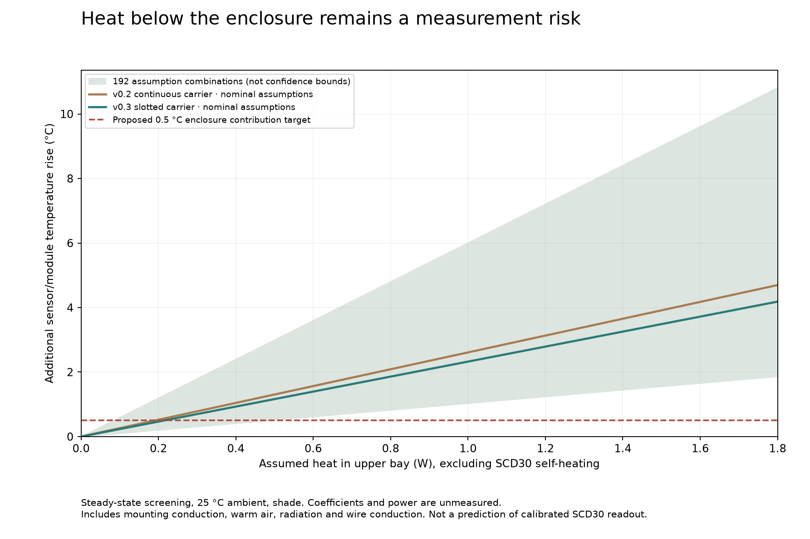

# Thermal screening — v0.3

**The small model does not establish negligible sensor warming.** At an assumed 0.8 W of heat in the upper bay, in shade, the nominal model gives **1.86°C additional module warming**, versus **2.09°C** with the previous continuous carrier. The 192 parameter combinations give **0.83–4.81°C** for the revised carrier. These are engineering scenarios, not measured results, confidence intervals or guaranteed limits.

The model therefore supports a cautious decision: keep the sensor below the electronics and shade it, reduce the solid mounting path, and test one working prototype before classroom production. It does **not** certify the SCD30 temperature or CO₂ readings. The proposed acceptance criterion is **≤0.5°C enclosure contribution** under the intended shaded operating conditions; the nominal scenarios do not meet it.

- [Two-page thermal review](thermal-review.pdf)
- [Chart](thermal-screen.png), [results CSV](results.csv), [machine-readable results](results.json)
- [All inputs, assumptions and source links](inputs.json), [reproducible Python model](model.py)

## What is modelled

Five steady-state nodes represent the upper bay/shell **H**, outer carrier **C**, central mounting area **M**, SCD30/module/PCB **S**, and under-skirt air **A**. Ambient is fixed at 25°C. Each node solves `sum(Gij × (Ti − Tj)) + Gi,ambient × Ti = Qi` for temperature rise above ambient. This is a lumped energy balance, not a spatial simulation or CFD.

Paths include conduction through the carrier, bosses, screws and cable copper; convection to the under-skirt air; effective radiation; heat rejection from the upper shell; and direct warm-air/radiation coupling from the bay to the central mounting area. Those bypass paths remain in the revised model. Added warm-air leakage through the slots is also included and varied.

The carrier now has a **52.5 × 28 mm central region**, **2 mm perimeter slots**, and **four 3 × 2.4 mm bridges** crossing those slots. It remains one printed piece. Dimensions come directly from `parameters.scad`. At assumed effective plastic conductivity 0.22 W/(m·K), `G = kA/L` gives **0.00317 W/K** through the four bridges, compared with **0.0425 W/K** through an idealized continuous perimeter. That is about 93% less conduction through *this local plastic path*, but only about **11% less module warming** in the nominal network. The unchanged air/radiation paths explain the difference. The old plate comparison idealizes the perimeter and omits the small cable-notch interruption.

At 0.8 W, the paired scenario changes range from **0.10°C worse to 0.92°C better**. The slots are a provisional design change, not a proven improvement under every condition; enough warm-air leakage can erase their benefit. Their strength and the airflow effect both need testing. Do not plug the slots with foam or inadvertently bridge them with a cable tie if testing this geometry.

The SCD30 self-heating input is **0.0627 W = 3.3 V × 19 mA** at one measurement per two seconds. This is a datasheet-based module estimate, excluding breakout overhead. For each result we subtract a second solution with identical SCD30 self-heating but zero upper-bay heat. That isolates the *extra* module warming. It does not model the internal SHT31 location, package gradients or the SCD30's temperature-offset compensation, and is not directly a predicted error in its reported temperature. [Sensirion datasheet, pp. 1–2](https://sensirion.com/media/documents/4EAF6AF8/61652C3C/Sensirion_CO2_Sensors_SCD30_Datasheet.pdf)

Sensirion recommends distance from heat sources, placement below them, access to ambient air and protection from sunlight; it also describes compensation for residual heating. Those recommendations justify the layout direction, but do not provide numerical coefficients for this enclosure. [Sensirion design-in guide, pp. 1–3](https://sensirion.com/media/documents/84D49268/616536CB/Sensirion_CO2_Sensors_SCD30_Design-In_Guidelines_D1.pdf)

## Assumptions and limits

The **0.4, 0.8 and 1.5 W** upper-bay loads are chosen screening cases. They are **not measured Feather power**, battery runtime estimates or charger ratings. USB operation can charge the battery concurrently, so that operating mode must be measured separately. Stored chemical charging energy is not all heat; an eventual measured heat budget should account for this rather than equating all USB input power with dissipation. [Adafruit power management](https://learn.adafruit.com/esp32-s3-reverse-tft-feather/power-management)

Heat-transfer coefficients, air exchange, contact resistance, wire gauge and printed-plastic conductivity are unmeasured. The parameter sweep varies six coupling terms and plastic conductivity, while other terms remain fixed; it does not span every uncertainty. It does not establish a PLA-versus-PETG performance difference. The nominal calculation gives no automatic cooling credit to vents beyond the assumed upper-bay heat rejection.

The two sunlight stress cases apply `absorbed heat = absorptance × irradiance × top area`, with **800 W/m²** and hypothetical absorptances **0.25 / 0.8**. The top area is 0.006072 m², giving **1.21 / 3.89 W** extra heat. These absorptances are not known properties of the eventual filament. Side sunlight, hot ground/table, direct/reflected light on the sensor, wind and rain are omitted. Large temperature rises also weaken the linearized-radiation assumption. Treat the sun cases as a warning that the small skirt is insufficient evidence of outdoor accuracy, not a reliable outdoor forecast.

No thermal mass or time dependence is modelled. This calculation cannot supply a warm-up time, capture Wi-Fi/charging transients, or prove spatial temperature uniformity inside the SCD30.

## Pilot measurement procedure

1. Use a separate shaded reference thermometer capable of resolving the proposed 0.5°C change. Keep it adjacent to, but out of contact with, the SCD30. Keep the sensor's height, supporting surface, room airflow, measurement interval and firmware temperature offset fixed. Record the actual offset; do not tune it separately between runs.
2. Establish an exposed-sensor baseline with the powered heat-producing boards separated from it, using a temporary longer QT test lead if necessary. Record SCD30 temperature/RH/CO₂ and reference temperature. Use a nonconductive support and avoid hand/breath warming. Measure actual operating power and note battery voltage/state of charge.
3. Assemble the device and repeat at the same sensor location in shade. Log at least 30 minutes and extend until the five-minute mean changes by less than 0.05°C over consecutive windows. This is a proposed settling criterion, not a datasheet warm-up specification. Repeat the exposed baseline afterward (A–B–A) to detect ambient drift.
4. Calculate the change in `SCD30 temperature − reference temperature` between settled enclosed and exposed runs. Repeat with hotspot/display active, screen dimmed, USB without charging, and USB charging a partially discharged pack. Keep raw logs and report the reference uncertainty and run-to-run spread. CO₂/RH behaviour must also be checked; the thermal network does not predict their accuracy.
5. Aim for **≤0.5°C extra enclosure contribution** in the intended workshop mode. If that fails, first measure the heat budget and compare the original solid carrier with the slotted carrier. Then test more separation, a greater air gap or a different mounting path before changing many features together. An external temperature sensor is an option if robust ambient temperature is essential; it is not added to the current BOM.
6. Treat outdoor use as a separate experiment. Start with an externally shaded device and a shaded reference; later compare controlled sun/shade transitions and table surfaces. Do not adopt one constant temperature offset as a cure for changing solar or charging heat.

## Reproduce

Run `python enclosure/thermal/model.py` using the CAD requirements environment. The script regenerates JSON, CSV, PNG and PDF and checks energy conservation, equation residuals, zero-added-power response, positive conductances and proportionality to power. Passing those checks establishes that the numerical implementation follows this model; it does not validate the physical assumptions.
