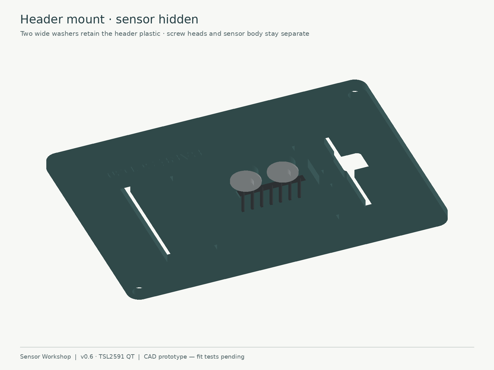

# Erez's personal prototype — bare Sensirion SCD30

This is the one-off version for the **bare 35 × 23 mm Sensirion SCD30** confirmed by Erez. The workshop build continues to use the Adafruit QT breakout. No electronics-order quantities or workshop production files are changed.

**Print one of each file from [prototype-stls/bare-scd30/](../../../prototype-stls/bare-scd30/):**

| File | Print orientation |
| --- | --- |
| `01-shell.stl` | Exterior roof on the bed; feet point up. This is the current TSL2591 shell. |
| `02-sensor-carrier-bare-scd30.stl` | Flat upper face on the bed; header pocket and screw bosses point up. |
| `03-feather-frame.stl` | Flat rear face on the bed; mounting pads point up. This is the reinforced v0.6 frame. |

The supplied orientations are already correct. Use millimetres, 100% scale, 0.4 mm nozzle and 0.2 mm layers. Start with five wall loops for the carrier and Feather frame. The carrier's largest pocket-end bridge is about 3 mm; no deliberate support is intended. The shell uses the [existing print guidance](../../PRINTING.md). No slicing has been performed here.

[Interactive personal model](model.html) · [Mounting and wiring drawing](mounting.pdf) · [OpenSCAD source](carrier.scad) · [Dimensions](parameters.scad) · [CAD checks](generated/validation.json)

## Mounting arrangement

The carrier captures the **plastic body of a seven-pin, 2.54 mm-pitch straight header** in a pocket. Two M2 screws and wide washers retain it from below. The SCD30 is soldered to the header's long legs, with the cavity facing down. Its PCB and optical chamber stay clear of the carrier and retainers. The two existing case-closure screws retain the carrier as before.

Sensirion specifies support through the contact pins and advises against applying force to the optical cavity. Its small PCB holes are therefore not used as screw mounts. [Handling and assembly guide, pp. 1–2](https://sensirion.com/media/documents/6E0DB3D9/616534F2/Sensirion_CO2_Sensors_SCD30_Assembly_Guideline.pdf)

The pocket is **18.18 × 2.94 mm**, designed around a **17.78 × 2.54 × 2.54 mm** header body. The washers seat against printed stops, leaving **0.36 mm nominal vertical play** rather than compressing the header. Two broad Ø6.4 mm bosses use Ø1.8 mm pilots. The header ends rest on 0.57 mm-wide seats above it; the surrounding walls locate it sideways. These seats carry the small sensor, not screw-tightening loads.

The carrier has a solder-access window that widens toward the inside for insulated joints, the original cable passage, two cable strain-relief slots and an underside **BARE SCD30** label. There are still **three printed pieces**. The HTML shows the sensor as a conservative clearance envelope, not an exact optical-chamber model.



## Hardware for this variant

Use the [normal mechanical kit](../../MECHANICAL-BOM.md) with these changes:

| Item | Quantity | Specification / change |
| --- | ---: | --- |
| Straight male header | 1 × 7 positions | 2.54 mm pitch, approximately 0.64 mm square pins; body approximately 17.78 × 2.54 × 2.54 mm. Long legs **at least 6 mm** face the sensor; approximately 2.5–3.3 mm tails face the soldered pigtail. Cut seven positions from a breakaway strip. |
| Wide retainer washers | 2 additional | Flat M2 washer, approximately **2.2 mm ID × 8 mm OD × 0.5 mm thick**. The small 5 mm RTC washers do not reach far enough. Keep the two RTC washers for the RTC. |
| Header-retainer screws | 2, already in the kit | Reuse the two proposed **M2×5 pan-head sensor screws**. These now fasten the header retainers, not the sensor PCB. |
| QT pigtail | 1 | A cable with one intact JST-SH 4-pin QT plug and four solderable wires at the other end; replaces the light-to-SCD30 QT cable. Start around **150 mm**, leaving a relaxed service loop to lower the carrier. |
| Cable strain-relief tie | 1 additional | 2.5 mm-wide flexible nylon, approximately 100–150 mm long; trim the tail. |
| Joint insulation | As needed | Small individual heat-shrink sleeves for the four wired pins; keep joints separate from unused pins. |

Total mechanical kit: **10 screws, 4 washers and 3 small zip ties**, before optional external mounting supplies. No nuts, inserts or extra printed clip. Measure the actual header and washers before assembly; header bodies and tail lengths vary. Do not force an oversized header into the pocket.

## Assembly

1. **Dry-fit the bare header first.** Place it in the pocket with its short tails through the access window. Fit the wide washers and screws gently against the printed stops. Check that the header is captured but not crushed, then remove it for soldering.
2. Solder **all seven long legs** to the module, outside the printed carrier. Keep the module parallel to the header. The design uses **3.56 mm between the header body's lower face and the module's PCB back plane**; with 6 mm legs and a 1.6 mm PCB, about **0.84 mm** protrudes for soldering. A removable approximately 3.5 mm spacer at the pin-row region can help establish that gap; do not press on the optical chamber or its components. Remove the spacer afterwards.
3. Solder the four pigtail wires to the corresponding short tails and insulate each joint. Leave the three other contacts unwired. Do this outside the print so the iron and hot joints cannot soften it. Do not trim the module-supporting legs after setting the gap.
4. Feed the intact QT plug through the **16.64 × 4.4 mm access window**, turning its narrow side across the slot, then seat the header in its pocket. The cavity faces down, away from the carrier. Install the two wide washers and M2 screws, approaching from below with a straight driver. The heads sit outside the sensor PCB outline. Stop at the printed seats; the washers must not touch the sensor.
5. Bring the insulated wire bundle toward the paired strain-relief slots near the left side of the carrier. Thread one tie through them and snug it around the insulated bundle. Keep it away from the sensor and solder joints. Leave slack between the tie and the header so cable handling does not pull on the pins.
6. Verify wiring with power disconnected. Plug the QT end into the light board's free socket, leave a service loop, and install the carrier with the usual two M3×8 closure screws. Check that the lead avoids the battery, Feather rails and closing edge.

For removal, lower the complete carrier and unplug its pigtail. Remove the header retainers on the table; do not pull the sensor body to unplug or free it.

## Qwiic lead wiring

Identify contacts from the **cavity-side drawing**, with the row of seven holes above the optical chamber. From left to right the contacts are **VDD, GND, SCL, SDA, RDY, PWM, SEL**. Turning the sensor over reverses the apparent order. [Sensirion datasheet, p. 5](https://sensirion.com/media/documents/4EAF6AF8/61652C3C/Sensirion_CO2_Sensors_SCD30_Datasheet.pdf)

| QT function | Usual QT cable colour | Bare SCD30 contact |
| --- | --- | --- |
| 3.3 V supply | Red | VDD, pin 1 |
| Ground | Black | GND, pin 2 |
| Clock | Yellow | TX/SCL, pin 3 |
| Data | Blue | RX/SDA, pin 4 |
| — | No wire | RDY, PWM and SEL, pins 5–7 |

Use the **Feather's regulated 3.3 V QT bus** for this prototype. Sensirion's ESP32 example uses 3.3 V power and direct SDA/SCL connections; leaving SEL floating selects I²C. This pigtail does not add the regulator or level shifting found on the Adafruit breakout. [Sensirion wiring reference](https://github.com/Sensirion/arduino-i2c-scd30#connect-the-sensor)

The colour mapping above is the **QT cable convention**, not the colours of Sensirion's own cable. Match labels and check continuity rather than relying only on colour. [Adafruit QT pinout](https://learn.adafruit.com/introducing-adafruit-stemma-qt/technical-specs)

## Checks and limits

The build checks three watertight print solids, the unchanged closure interface, header capture, body/washer clearance, straight screwdriver access and 81 poses along the carrier's removal path. The shell and Feather frame copies must exactly match the workshop STLs. The sensor envelope includes 35 × 23 mm plan dimensions and a conservative 7.7 mm total thickness. Reference PDFs and hashes are recorded in [references.json](references.json).

Physical fit, soldering, retention and temperature accuracy remain untested. Check that the received header and washers fit and that the sensor body remains clear on every side. The workshop thermal estimate does not validate this different mounting path. Sensirion recommends recalibration after mounting; follow its procedure rather than assuming an arbitrary indoor CO₂ value. [Assembly guide](https://sensirion.com/media/documents/6E0DB3D9/616534F2/Sensirion_CO2_Sensors_SCD30_Assembly_Guideline.pdf)

To rebuild, use the repository CAD Python environment and OpenSCAD:

```sh
python enclosure/variants/bare-scd30/build.py
python enclosure/variants/bare-scd30/check_viewer.py
```

Run the main enclosure generation first if its ignored `generated/scene/` cache is absent. This variant reads those meshes and the main offline model, but writes only its own files and `prototype-stls/bare-scd30/`.
