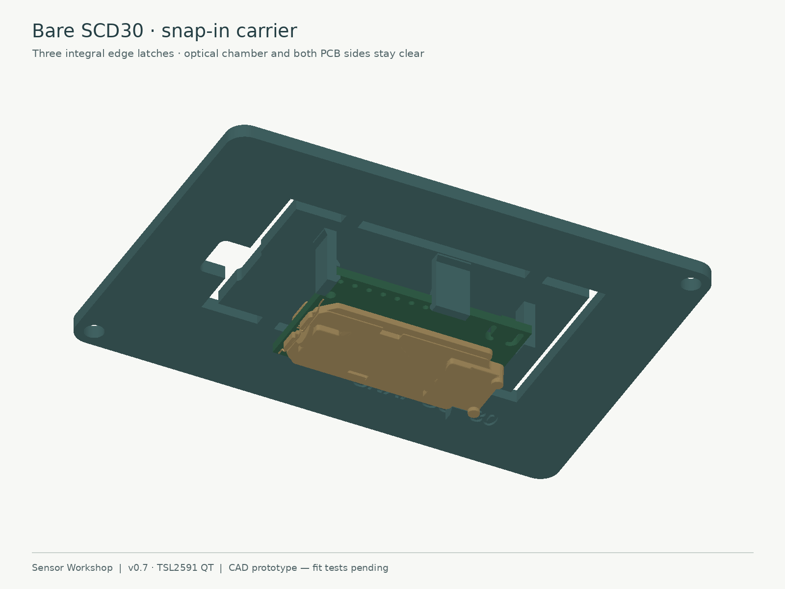
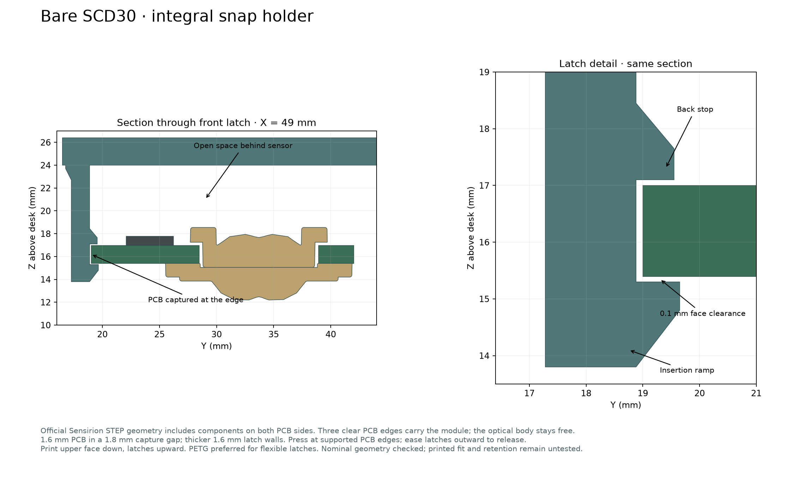

# Erez's personal prototype — snap-in bare SCD30

This one-off carrier holds the **bare 35 × 23 mm Sensirion SCD30** directly with **three integral PCB-edge latches**. There is no header clamp, separate printed clip or sensor mounting screw. The workshop build still uses its Adafruit QT breakout and original carrier.

**[Complete three-file print folder](../../../prototype-stls/bare-scd30/)** · [Interactive model](model.html) · [Section drawing](mounting.pdf) · [OpenSCAD source](carrier.scad)

| Print one of each | Supplied print orientation |
| --- | --- |
| `01-shell.stl` | Exterior roof on the bed; feet point up. Current TSL2591 shell. |
| `02-sensor-carrier-bare-scd30.stl` | Flat upper face on the bed; integral latches point up. Strengthened, closer-fitting latches. |
| `03-feather-frame.stl` | Flat rear face on the bed; mounting pads point up. Corrected v0.7 frame: LED clearance and USB/SCREEN SIDE marks. |

The shell and frame are exact copies of the workshop files. Use millimetres and 100% scale. For the carrier, start with a 0.4 mm nozzle, 0.2 mm layers and five wall loops. **PETG is preferred for the flexible latches**; treat PLA as a careful first-fit trial. The latch noses have short 0.77 mm inward projections and sloped entry faces; the back stops grow on ramps. No deliberate supports are intended, but actual print quality must be checked. See the [existing shell/frame guidance](../../PRINTING.md). No slicing has been performed here.

**25 November revision:** reprint the carrier and Feather frame; reuse the shell. After the first clips proved flimsy and loose, their walls increased from **1.1 to 1.6 mm**, the two unobstructed clips widened to **4.2 and 6 mm**, and the retaining overlap increased from **0.4 to 0.65 mm**. The corner clip stays 3.4 mm wide to clear the optical body. Retaining noses are now 0.5 mm thick, and the vertical play halves from 0.4 to 0.2 mm. These changes need a new physical fit trial.

## How it holds the module

The holder was laid out against **Sensirion's detailed STEP model**, including the optical chamber and components on **both PCB sides**. Three clear PCB edges sit between small back stops and sloped retaining noses. A plain stop on the fourth edge limits sideways movement. The nominal **1.6 mm PCB sits in a 1.8 mm capture gap**, leaving 0.1 mm at each face, with 0.12 mm side clearance. The optical body is not a contact surface.

The PCB back plane is 7 mm below the carrier plate. The model's tallest rear component leaves approximately **5.45 mm of air space** to the plate; the chamber's lowest point is approximately **11.54 mm above the desk**. The existing thermal slots, closure holes, mating rim and cable opening are retained.





The HTML retains individual component visibility and the explosion slider. Its SCD30 checkbox toggles the entire detailed module. **The original cable illustration is restored unchanged**; it is only an illustration for the soldered lead, not a specified solder-joint or routing design.

## Assembly and removal

1. Finish soldering and insulating your pigtail **outside the print**, then let the module cool. Inspect the three latch tips for blobs or rough edges before fitting.
2. Keep the carrier outside the case, with its latches facing you. Orient the module as shown in the model: **optical chamber away from the carrier**. The row of seven contacts runs along the edge with the central latch, towards the left-hand corner latch.
3. Align the PCB between the guides. Gently ease the latch tips outwards as needed and press **only at the supported PCB edges** until all three noses sit over the edge. Do not press on the optical chamber or small components. Stop if the print needs force; remove any local roughness and reassess the fit.
4. Check that all three edges are retained, the board has a little clearance rather than being squeezed, and no component touches the plastic. Connect the lead and install the carrier with the usual two case screws.

For removal, take the carrier out of the case. Support the PCB, ease each latch outward just enough to free its edge and lift the module out gently. Do not pull on the chamber or wires. Printed fit, release force and retention still need the first physical test.

## Hardware for this variant

Use the [workshop mechanical kit](../../MECHANICAL-BOM.md), **omitting the two SCD30 M2×5 screws**. The personal set therefore needs **6 board screws + 2 case screws = 8 screws total, 2 RTC washers and 2 battery zip ties**, before optional external mounting supplies. No header, wide retainer washers, extra strain-relief tie, nuts or inserts are required by this holder. Your soldered QT lead and joint insulation are still needed electrically.

For the lead's electrical connections, use the [Sensirion pinout and ESP32 wiring reference](https://github.com/Sensirion/arduino-i2c-scd30#connect-the-sensor). The mount does not add a regulator or level shifter.

## Checks and limits

The [exact STEP checks](generated/sensor-step-checks.json) verify that the three latch profiles and side stop clear all 25 manufacturer solids, that each latch captures the PCB in both vertical directions, and that the nominal insertion path clears non-PCB components. An opening-clearance check translates each latch outward; it is **not a simulation of bending or insertion force**.

The [assembly checks](generated/validation.json) cover three connected, watertight print solids, the unchanged closure interface, sensor/carrier clearances and 81 positions along the carrier's removal path. The [browser checks](generated/viewer-checks.json) cover every visibility control, explosion, section and offline rendering. Source hashes are in [references.json](references.json).

This requested PCB-edge snap is a personal prototype that differs from Sensirion's recommended pin-supported mounting. The clearance gap avoids designed preload, but printed fit, retention, handling stress and temperature accuracy remain untested. Sensirion recommends recalibration after mounting. [Manufacturer assembly guide](https://sensirion.com/media/documents/6E0DB3D9/616534F2/Sensirion_CO2_Sensors_SCD30_Assembly_Guideline.pdf)

To rebuild, use the CAD Python environment, OpenSCAD and FreeCAD's Python. The build downloads the pinned manufacturer STEP archive, verifies its hash, converts it and checks the clip regions before generating the outputs:

```sh
python enclosure/variants/bare-scd30/build.py
python enclosure/variants/bare-scd30/check_viewer.py
```

On macOS, the default FreeCAD Python is `/Applications/FreeCAD.app/Contents/Resources/bin/python`; set `FREECAD_PYTHON` to a Python executable that can import FreeCAD and Part on other installations. Run the main enclosure generation first if its ignored `generated/scene/` cache is absent. This variant writes only its own files and `prototype-stls/bare-scd30/`.
