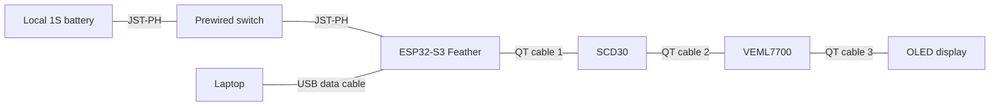

# Proposed bill of materials

Supplier pages checked **12 November 2026**. Quantities below are per device. Stock and prices are the listings returned during research, not reserved inventory or a quotation; some supplier pages may be cached. Confirm the required class quantity before ordering. Prices are single-unit USD, excluding shipping and taxes.

This proposal uses **Adafruit-manufactured boards**, following the preference for a mainstream Adafruit product. Batteries will be purchased locally in Israel. No purchases have been made.

## Recommended components

| Item | Qty/device | Exact part | Supplier and listed stock | Unit USD | Extended USD |
| --- | ---: | --- | --- | ---: | ---: |
| Microcontroller | 1 | Adafruit **5323**, ESP32-S3 Feather, **8 MB flash / no PSRAM**, onboard antenna | [Digi-Key 1528-5323-ND](https://www.digikey.com/en/products/detail/adafruit-industries-llc/5323/16376065): 800; [Adafruit](https://www.adafruit.com/product/5323): 72 | 17.50 | 17.50 |
| CO₂, temperature, humidity | 1 | Adafruit **4867**, assembled SCD30 STEMMA QT breakout | [Adafruit](https://www.adafruit.com/product/4867): 86 | 58.95 | 58.95 |
| Ambient light | 1 | Adafruit **4162**, VEML7700 **STEMMA QT revision** | [Adafruit](https://www.adafruit.com/product/4162): in stock; quantity not displayed | 4.95 | 4.95 |
| Display | 1 | Adafruit **938**, 1.3-inch 128 × 64 monochrome OLED, **STEMMA QT revision** | [Adafruit](https://www.adafruit.com/product/938): in stock; quantity not displayed | 19.95 | 19.95 |
| Sensor/display interconnects | 3 | Adafruit **4210**, 100 mm JST-SH 4-pin to JST-SH 4-pin STEMMA QT / Qwiic cable | [Digi-Key 1528-4210-ND](https://www.digikey.com/en/products/detail/adafruit-industries-llc/4210/10230021): 27,853 | 0.95 | 2.85 |
| Battery power switch | 1 | Adafruit **3064**, prewired JST-PH 2-pin extension with on/off switch | [Digi-Key 1528-1679-ND](https://www.digikey.com/en/products/detail/adafruit-industries-llc/3064/6022074): 167 | 2.95 | 2.95 |
| USB-C laptop cable | 1 | Adafruit **4199**, USB-C to USB-C data cable, 1 m | [Adafruit](https://www.adafruit.com/product/4199): in stock; quantity not displayed | 9.95 | 9.95 |
| USB-A laptop cable | 1 | Adafruit **4474**, USB-A to USB-C data cable, approximately 1 m | [Adafruit](https://www.adafruit.com/product/4474): in stock; quantity not displayed | 4.95 | 4.95 |
| Rechargeable battery | 1 | Local protected 1S pack meeting the specification below; exact model TBD | **Local purchase in Israel**; availability and price not checked | TBD | TBD |

The electronics, QT cables, and switch subtotal is **$107.15**. Including both laptop cable types gives **$122.05 per kit**, before the battery, enclosure, shipping, and taxes. Providing both cable types avoids depending on students' adapters; alternatively, distribute one appropriate data cable per laptop and keep the other type in a shared supply.

The 100 mm QT cable and switched battery lead were **out of stock at Adafruit** on the retrieved product pages, so the BOM specifies Digi-Key for those two items. Search snippets showed older availability; the product-page results take precedence. The remaining electronics can be ordered directly from Adafruit. All quantities require reconfirmation when the headcount is known.

## Optional clock

| Item | Qty/device | Exact part | Supplier and listed stock | Unit USD |
| --- | ---: | --- | --- | ---: |
| RTC | 1 | Adafruit **5188**, DS3231 Precision RTC **STEMMA QT** breakout | [Adafruit](https://www.adafruit.com/product/5188): in stock; quantity not displayed | 13.95 |
| Additional QT cable | 1 | Adafruit **4210**, 100 mm | [Digi-Key](https://www.digikey.com/en/products/detail/adafruit-industries-llc/4210/10230021): 27,853 | 0.95 |
| RTC backup battery | 1 | **CR1220, 3 V**, non-rechargeable coin cell | Local purchase in Israel; exact supplier TBD | TBD |

The RTC adds **$14.90 plus the coin cell**. It retains calendar time when the main battery is disconnected. It is useful for independent logging, but can be omitted for an initial exercise that sets the device's clock from the phone browser after each restart. A hotspot alone does not supply internet time. If included, use the same RTC configuration in every student kit. The [DS3231 product page](https://www.adafruit.com/product/5188) specifies the separate CR1220 requirement.

## Why this Feather

The [Adafruit 5323 product page](https://www.adafruit.com/product/5323) documents native USB-C, a battery connector and charger, STEMMA QT, 8 MB flash, Wi-Fi, and an onboard battery monitor. No GPIO headers need to be soldered for this project. Select the onboard-antenna version, avoiding an extra antenna assembly.

Native USB avoids a separate CH340/CH9102/CP210x USB-to-UART bridge. Espressif documents USB CDC support without a separately installed driver on most modern Windows, macOS, and Linux systems. This is a good match for mixed student laptops, but is not a guarantee that every laptop, USB hub, cable, or firmware configuration will work without setup. Keep BOOT and RESET accessible for recovery. [Espressif USB documentation](https://docs.espressif.com/projects/esp-idf/en/stable/esp32s3/api-guides/usb-otg-console.html)

**Software assumption: Arduino/C++ for the reference firmware.** This board has no PSRAM; Adafruit discourages it for substantial CircuitPython applications. If teaching Python becomes a requirement, revisit the board before ordering. The Adafruit **5477** version has 4 MB flash and 2 MB PSRAM, but was out of stock at both [Adafruit](https://www.adafruit.com/product/5477) and [Digi-Key](https://www.digikey.com/en/products/detail/adafruit-industries-llc/5477/16583982). It is not the current procurement recommendation.

The 8 MB flash is shared by firmware, boot/partition data, and the logging filesystem. The eventual firmware must choose an appropriate partition layout; 8 MB is not all available for CSV files. Validate logging capacity once the record format and sampling interval are defined.

## Solderless connections

For the RTC configuration, insert the RTC between the light sensor and OLED: four QT cables total. Keep the OLED at the end of the chain. A hub is unnecessary for this layout. QT cables carry power, ground, SDA, and SCL; the battery uses its separate **2-pin JST-PH** connection, not a Qwiic cable.

| Device | I²C address | Notes |
| --- | --- | --- |
| SCD30 | `0x61` | Fixed; [Sensirion interface specification](https://sensirion.com/media/documents/D7CEEF4A/6165372F/Sensirion_CO2_Sensors_SCD30_Interface_Description.pdf) |
| VEML7700 | `0x10` | Fixed; [Adafruit driver](https://github.com/adafruit/Adafruit_CircuitPython_VEML7700/blob/main/adafruit_veml7700.py) |
| SSD1306 OLED | `0x3C` or `0x3D` | Scan the delivered board and configure the library; [product details](https://www.adafruit.com/product/938) |
| Feather MAX17048 | `0x36` | Built in on current revisions; older revisions used LC709203 at `0x0B`; [Feather pinouts](https://learn.adafruit.com/adafruit-esp32-s3-feather/pinouts) |
| Optional DS3231 | `0x68` | [RTC guide](https://learn.adafruit.com/adafruit-ds3231-precision-rtc-breakout?view=all) |

These addresses do not conflict. The breakouts support the Feather's 3.3 V I²C connection. Purchase the assembled QT breakouts, not bare sensor ICs or old header-only revisions. The current OLED ships in I²C mode with automatic reset, so it needs neither solder-jumper changes nor a separate reset wire. [OLED wiring guide](https://learn.adafruit.com/monochrome-oled-breakouts/wiring-128x64-oleds)

**SCD30 integration detail:** Sensirion recommends an I²C clock of 50 kHz or less and specifies clock stretching up to 150 ms. The reference firmware must accommodate this, including display-library calls that might otherwise change the shared bus speed. Test the selected ESP32 core, sensor library, and display together before committing to the class order. This is a documentation-based compatibility assessment, not a completed hardware test. [SCD30 interface specification](https://sensirion.com/media/documents/D7CEEF4A/6165372F/Sensirion_CO2_Sensors_SCD30_Interface_Description.pdf)

The Feather's QT supply is switchable. Ensure the board's I²C power control is enabled before accessing the modules; the supported board setup normally does this. Use the correct Adafruit Feather ESP32-S3 No PSRAM board definition. [Feather guide](https://learn.adafruit.com/adafruit-esp32-s3-feather?view=all)

## Battery specification for the local order

- One **protected single-cell Li-ion/LiPo pack**, approximately **2,000–2,500 mAh**, **3.7 V nominal / 4.2 V full charge**.
- A pre-attached **JST-PH 2-pin, 2.0 mm-pitch** plug with polarity matching the Feather's BAT and GND connections. The connector shape alone does not establish polarity.
- For procurement, request a pack rated for at least **1 A continuous discharge** and **500 mA charging**, providing margin for the proposed device. These are requested pack capabilities, not a claim about measured device consumption or the Feather's charge current.
- Obtain the actual pack drawing, lead length, and connector orientation before enclosure CAD. Do not substitute a bare cell requiring soldered tabs or a student-wired holder.

The Feather provides USB charging, so a separate charger is unnecessary. With the inline switch open, the battery is disconnected: USB can still run the device, but charging requires the switch to be closed. The switch cable is approximately 20 inches long; allow space for the excess cable or choose a verified shorter prewired equivalent before CAD. [Feather power connections](https://learn.adafruit.com/adafruit-esp32-s3-feather/pinouts), [switched lead](https://www.adafruit.com/product/3064)

## Enclosure inputs and pilot validation

The SCD30 breakout is approximately **51.0 × 25.4 × 8.8 mm**, and the OLED board approximately **35.6 × 33 × 6.2 mm**. Use the current PCB drawings and actual received parts for mounting-hole positions and clearances, rather than these overall dimensions alone. [SCD30 dimensions](https://www.adafruit.com/product/4867), [OLED dimensions](https://www.adafruit.com/product/938)

The enclosure should provide airflow around the CO₂ sensor, a clear optical opening for the light sensor, a display window, USB-C access, accessible BOOT/RESET buttons, and strain relief for the battery and switch. Keep the light sensor shielded from the OLED and board LEDs. Keep heat from the ESP32 and charging circuitry away from the environmental sensor. Printed retainers and/or screws can secure the assembled boards; the screw sizes, quantities, and enclosure material remain TBD until CAD.

Before a class-sized purchase, assemble two pilot kits and check upload/recovery on macOS (including Apple Silicon), Windows, and Linux; the complete I²C chain; Wi-Fi hotspot operation during logging and CSV downloads; battery-to-USB transitions; current draw and charging; and the local battery's fit. Runtime and laptop compatibility remain unmeasured. Pin the software versions that pass this check for the workshop.

An alternative CO₂ option, if enclosure size later becomes a priority, is [Adafruit SCD41, product 5190](https://www.adafruit.com/product/5190), listed in stock at $49.95. It is smaller and supports low-power single-shot operation, but requires different firmware and has approximately 200 mA measurement peaks. Its published accuracy specification also differs from SCD30. It is **not included** in this BOM or its totals. [SCD41 power notes](https://learn.adafruit.com/adafruit-scd-40-and-scd-41/pinouts), [Sensirion low-power guide](https://sensirion.com/media/documents/077BC86F/62BF01B9/CD_AN_SCD4x_Low_Power_Operation_D1.pdf)
