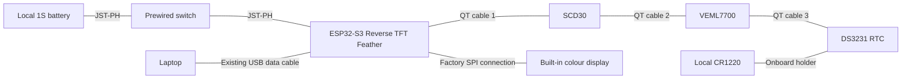

# Proposed bill of materials

Supplier listings researched **12 November 2026**. These are retrieved product-page and search-index snapshots, some cached, rather than reserved inventory or live quotations. Prices are single-unit USD before shipping and taxes. Delivery eligibility and the final price for Israel must be checked in the distributor cart.

The selected controller is the **Adafruit ESP32-S3 Reverse TFT Feather, product 5691**. It combines the microcontroller, colour screen, and three buttons. The **DS3231 RTC is included in every device**. Adafruit and SparkFun are both acceptable manufacturers. Both batteries will be purchased locally in Israel. No purchases have been made.

## Components and supplier links

Each distributor link identifies the same manufacturer part, not a bare sensor or a substitute. Quantities are for one device except the shared cable assortment. The price column is a reference unit price; distributor-specific observations are in [bom.csv](bom.csv).

| Component | Qty | Reference USD | Adafruit | Digi-Key | Mouser |
| --- | ---: | ---: | --- | --- | --- |
| ESP32-S3 Reverse TFT Feather; 1.14-inch 240 × 135 colour display; 4 MB flash / 2 MB PSRAM; PCB antenna | 1 | 24.95 | [5691](https://www.adafruit.com/product/5691) | [1528-5691-ND](https://www.digikey.com/en/products/detail/adafruit-industries-llc/5691/18627502) | [485-5691](https://www.mouser.com/en/ProductDetail/Adafruit/5691?qs=mELouGlnn3eeALy2e3r3sw%3D%3D) |
| SCD30 CO₂, temperature, and humidity breakout; assembled STEMMA QT board | 1 | 58.95 | [4867](https://www.adafruit.com/product/4867) | [1528-4867-ND](https://www.digikey.com/en/products/detail/adafruit-industries-llc/4867/13627674) | [485-4867](https://www.mouser.com/en/ProductDetail/Adafruit/4867?qs=pBJMDPsKWf0ru2aWSWVb%2FA%3D%3D) |
| VEML7700 ambient light sensor; STEMMA QT revision | 1 | 4.95 | [4162](https://www.adafruit.com/product/4162) | [1528-2891-ND](https://www.digikey.com/en/products/detail/adafruit-industries-llc/4162/9997696) | [485-4162](https://www.mouser.com/en/ProductDetail/Adafruit/4162?qs=unwgFEO1A6urZiNnCPSvkw%3D%3D) |
| DS3231 Precision RTC; STEMMA QT breakout | 1 | 13.95 | [5188](https://www.adafruit.com/product/5188) | [1528-5188-ND](https://www.digikey.com/en/products/detail/adafruit-industries-llc/5188/15189155) | [485-5188](https://www.mouser.com/en/ProductDetail/Adafruit/5188?qs=TCDPyi3sCW0TSTr1Xi7pUg%3D%3D) |
| Prewired JST-PH 2-pin battery extension with on/off switch | 1 | 2.95 | [3064](https://www.adafruit.com/product/3064) | [1528-1679-ND](https://www.digikey.com/en/products/detail/adafruit-industries-llc/3064/6022074) | [485-3064](https://www.mouser.com/en/ProductDetail/Adafruit/3064?qs=PqFvFmEiOr7sEj9KUBUBhw%3D%3D) |
| [SparkFun Qwiic Cable Kit, KIT-15081](https://www.sparkfun.com/sparkfun-qwiic-cable-kit.html), 10 assorted cables for prototyping | 1 shared kit | 12.95 | Exact kit not found | [1568-15081-ND](https://www.digikey.com/en/products/detail/sparkfun-electronics/15081/9770723) | [474-KIT-15081](https://www.mouser.com/en/ProductDetail/SparkFun/KIT-15081?qs=0lSvoLzn4L8uNN%252B5TDrwLw%3D%3D) |
| Final QT-to-QT cables, lengths selected after enclosure layout | 3/device | TBD | See cable options below | Bulk order after layout | Bulk order after layout |
| Protected 1S rechargeable battery, approximately 2,000–2,500 mAh | 1 | TBD | Local purchase in Israel | Local purchase in Israel | Local purchase in Israel |
| CR1220, 3 V, non-rechargeable RTC backup coin cell | 1 | TBD | Local purchase in Israel | Local purchase in Israel | Local purchase in Israel |
| Printed enclosure and mounting hardware | 1 set | TBD | Local fabrication | Local fabrication | Local fabrication |

The five per-device priced items total **$105.75**, including the RTC and switch, before QT cables, batteries, and enclosure. USB cables are excluded from procurement as requested; programming uses an existing USB data cable.

For the requested **one-device comparison**, each distributor list includes those five items plus **one SparkFun cable assortment**, for a reference subtotal of **$118.70**. The assortment supplies the prototype's three QT connections, so the comparison does not also buy three individual cables. It is a shared prototyping expense, not a recommendation to buy an assortment for every student. See [ordering files and cart status](ordering/README.md).

All six comparison items were listed in stock at Digi-Key and Mouser in the retrieved listings. For the four boards, the observed Digi-Key / Mouser counts were: Feather **1,730 / 214**, SCD30 **139 / 16**, VEML7700 **536 / 324**, RTC **748 / 158**. These counts may be stale; Mouser's SCD30 listing in particular should be rechecked before a class order. Adafruit listed the Feather at **34** and SCD30 at **86**, with the light sensor and RTC also in stock. The switched battery lead was out of stock directly at Adafruit, with stock listed at both distributors.

## Cable procurement

SparkFun's **KIT-15081** is the remembered assortment: ten cables of mixed lengths, including jumper-ended styles. It is not ten identical QT-to-QT leads. Use only the QT-to-QT leads in the student device. Digi-Key currently identifies this kit as manufacturer part **15081**, with ordering code **1568-15081-ND**; Mouser retains **KIT-15081**.

Use one assortment to try the component arrangement. Then buy the selected lengths in bulk: **three cables per device plus approximately 10% spares**, rounded up. The final lengths remain open until enclosure layout. Likely candidates are 50 mm and 100 mm, with 200 mm available for routing experiments:

| Cable option | Manufacturer link | Reference USD | Observation |
| --- | --- | ---: | --- |
| Flexible Qwiic, 50 mm | [SparkFun PRT-17260](https://www.sparkfun.com/flexible-qwiic-cable-50mm.html) | 1.50 | Listed in stock |
| Flexible Qwiic, 100 mm | [SparkFun PRT-17259](https://www.sparkfun.com/flexible-qwiic-cable-100mm.html) | 1.95 | Listed in stock |
| Flexible Qwiic, 200 mm | [SparkFun PRT-17258](https://www.sparkfun.com/flexible-qwiic-cable-200mm.html) | 1.95 | Listed in stock |
| Standard STEMMA QT / Qwiic, 100 mm | [Adafruit 4210](https://www.adafruit.com/product/4210), [Digi-Key 1528-4210-ND](https://www.digikey.com/en/products/detail/adafruit-industries-llc/4210/10230021) | 0.95 | Digi-Key listed stock; Adafruit direct out of stock |

These are alternatives for the later bulk order, excluded from the comparison imports. Purchase preassembled **4-pin JST-SH, 1 mm-pitch, QT-to-QT cables**, not loose connectors requiring crimping or soldering.

## Controller and firmware implications

The chosen Feather provides native **USB-C**, Wi-Fi, a battery connector and charger, a MAX17048 battery monitor, STEMMA QT, and a factory-connected SPI colour display. It needs no soldered headers or display wiring. Board plus screen costs **$24.95**, saving **$12.50** against the previous $17.50 Feather plus $19.95 separate OLED. The reverse layout places the screen and three buttons opposite the connectors, which suits an enclosure front panel. [Product](https://www.adafruit.com/product/5691), [overview](https://learn.adafruit.com/esp32-s3-reverse-tft-feather/overview)

Native USB avoids a separate USB-to-UART bridge. Most modern Windows, macOS, and Linux systems support USB CDC without a separate driver, but the workshop setup still needs testing with representative laptops, cables, and hubs. Keep BOOT and RESET accessible. [Espressif USB documentation](https://docs.espressif.com/projects/esp-idf/en/stable/esp32s3/api-guides/usb-otg-console.html)

The board has **4 MB flash and 2 MB PSRAM** and supports Arduino and CircuitPython. The teaching environment remains to be chosen. Flash is shared by firmware, partitions, and the logging filesystem; it is not all available for CSV files. Define the record format, sampling interval, and partition layout before estimating log duration. No SD card is planned.

The DS3231 keeps calendar time when the main battery is disconnected. Its separate **CR1220** is not included with the board and will be sourced locally. The firmware must provide initial clock setting, for example from the phone browser; the hotspot alone does not supply internet time. [RTC product](https://www.adafruit.com/product/5188)

## Solderless connections

Three QT cables connect the three external modules. A hub is unnecessary. QT cables carry 3.3 V power, ground, SDA, and SCL. The main battery uses a separate **2-pin JST-PH** connector; the display is already connected on the Feather.

| Device | I²C address | Source |
| --- | --- | --- |
| SCD30 | `0x61` | [Sensirion interface specification](https://sensirion.com/media/documents/D7CEEF4A/6165372F/Sensirion_CO2_Sensors_SCD30_Interface_Description.pdf) |
| VEML7700 | `0x10` | [Adafruit driver](https://github.com/adafruit/Adafruit_CircuitPython_VEML7700/blob/main/adafruit_veml7700.py) |
| Feather MAX17048 | `0x36` | [Reverse TFT Feather pinouts](https://learn.adafruit.com/esp32-s3-reverse-tft-feather/pinouts) |
| DS3231 | `0x68` | [RTC guide](https://learn.adafruit.com/adafruit-ds3231-precision-rtc-breakout?view=all) |

These addresses do not conflict. Purchase the assembled QT breakouts, including the current QT revision of the VEML7700. The TFT uses SPI and has no I²C address.

**SCD30 integration:** Sensirion recommends I²C at 50 kHz or less and specifies clock stretching up to 150 ms. Validate the selected ESP32 core and sensor library with the entire chain. TFT updates do not use this bus. This is a documentation-based compatibility assessment, not a hardware test. [SCD30 specification](https://sensirion.com/media/documents/D7CEEF4A/6165372F/Sensirion_CO2_Sensors_SCD30_Interface_Description.pdf)

Use the **Adafruit Feather ESP32-S3 Reverse TFT** board definition. The shared display/QT power control, `TFT_I2C_POWER`, must be high before using the external modules or screen; supported board startup normally enables it. [Pinouts and power control](https://learn.adafruit.com/esp32-s3-reverse-tft-feather/pinouts)

## Local batteries and enclosure inputs

- Main pack: protected **1S Li-ion/LiPo**, approximately **2,000–2,500 mAh**, **3.7 V nominal / 4.2 V full charge**, with a pre-attached **JST-PH 2-pin, 2.0 mm-pitch** plug matching the Feather's polarity. Connector shape alone does not establish polarity.
- Request pack capabilities of at least **1 A continuous discharge** and **500 mA charging** for margin. These are procurement requirements, not measured consumption or a claim about the Feather's charging current.
- RTC cell: one **CR1220, 3 V, non-rechargeable** per device, bought locally in Israel.
- Obtain the main pack's dimensions, lead length, and connector orientation before CAD. Use an assembled pack rather than a bare cell needing soldered tabs or a student-wired holder.

The Feather supplies USB charging. With the inline switch open, USB can still power the board, but the battery cannot charge until the switch is closed. The proposed switched lead is approximately **508 mm / 20 inches** long; accommodate its slack or select a verified shorter prewired equivalent before final CAD. [Power connections](https://learn.adafruit.com/esp32-s3-reverse-tft-feather/pinouts), [switch](https://www.adafruit.com/product/3064)

Use the manufacturer's PCB files and actual received parts for mounting holes and clearances: [Reverse TFT Feather drawings and 3D model](https://learn.adafruit.com/esp32-s3-reverse-tft-feather/downloads), [SCD30 breakout](https://www.adafruit.com/product/4867). The SCD30 board is approximately **51.0 × 25.4 × 8.8 mm**.

Provide CO₂ sensor airflow, a clear opening for the light sensor, a display window, access to the three front buttons and USB-C, BOOT/RESET access, and battery/switch strain relief. Shield the light sensor from the screen and LEDs and separate the environmental sensor from ESP32/charging heat. Fasteners and printed retainers remain TBD until CAD.

Before ordering for the class, assemble pilot hardware and check upload/recovery on macOS including Apple Silicon, Windows, and Linux; the complete sensor chain; hotspot operation while logging and downloading CSV; battery/USB transitions; charging and current draw; and enclosure fit. Runtime and laptop compatibility remain unmeasured. Pin the software versions that pass these checks.
